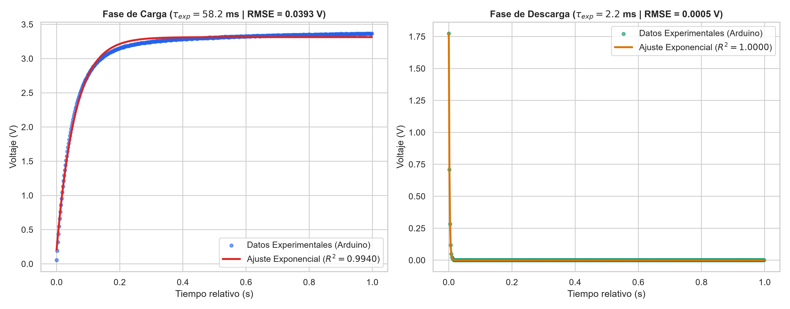
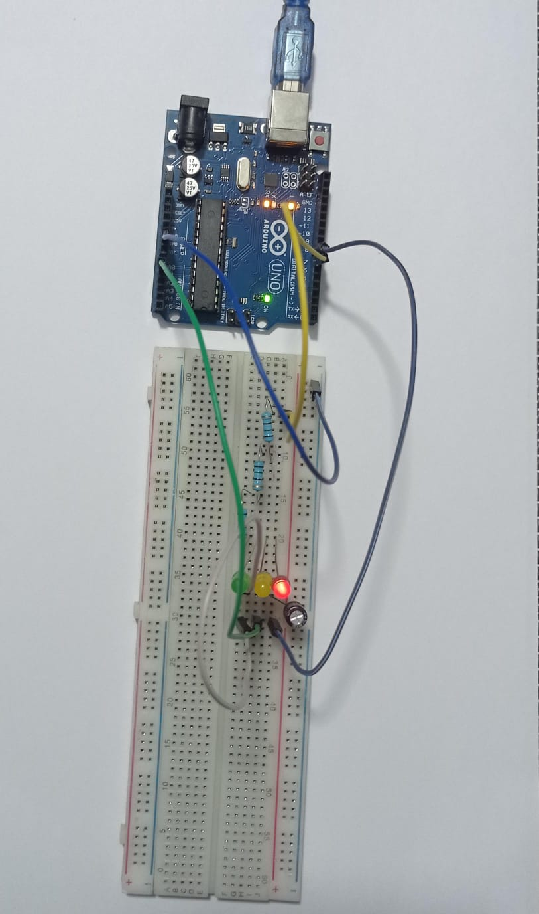
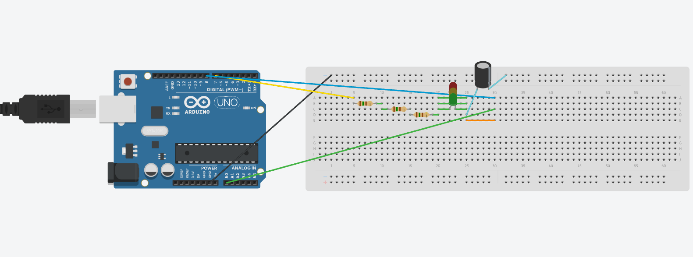
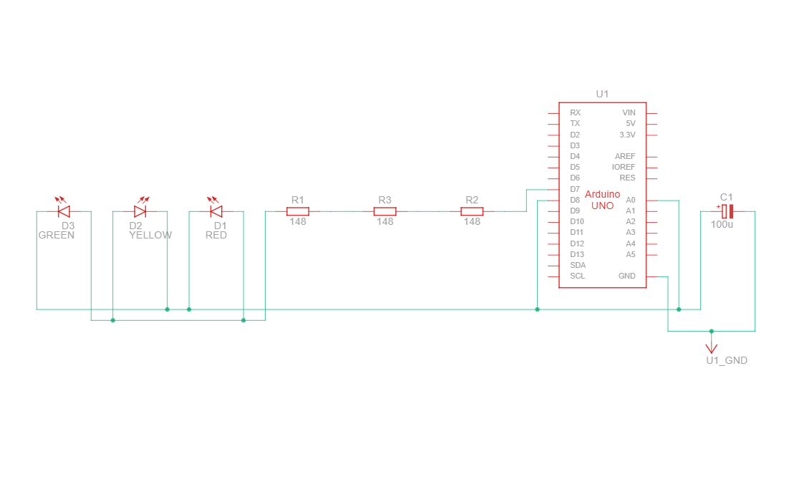
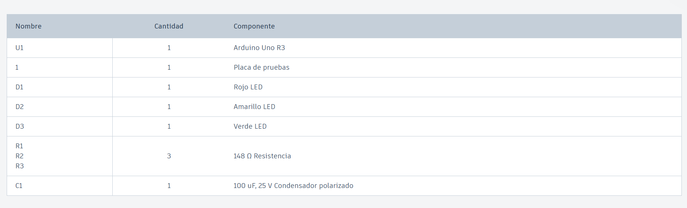
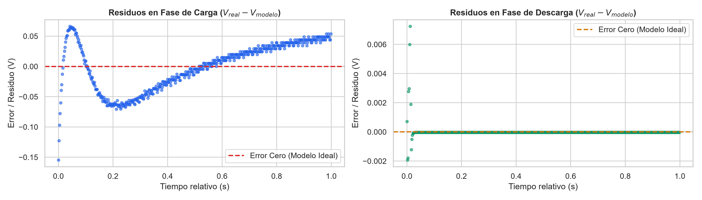

# Adquisición de Datos IoT y Modelado Físico de un Circuito RC No Lineal

Este proyecto implementa un pipeline completo de **Ingeniería de Datos y Física Experimental** (*End-to-End*) para capturar, procesar y modelar en tiempo real el comportamiento transitorio de un circuito **Resistencia-Capacitor (RC)** acoplado a un arreglo paralelo de diodos emisores de luz (**LEDs**).



## Objetivo del Proyecto
Integrar instrumentación electrónica (**Arduino Uno R3**) con un flujo de trabajo moderno en **Python** para validar experimentalmente las ecuaciones diferenciales de carga y descarga de un capacitor, analizando el impacto no lineal de los semiconductores en el circuito.

---

## Arquitectura y Hardware
El sistema físico fue construido y calibrado con los siguientes componentes:
* **Microcontrolador:** Arduino Uno R3 (muestreo ADC de 10 bits a ~500 Hz / 2 ms por muestra).
* **Banco Resistivo:** 3 resistencias de 147.8 Ω conectadas en serie ($R_{\text{total}} = 443.4\,\Omega$ medidas con multímetro).
* **Capacitor:** Electrolítico de $C = 100\,\mu\text{F}$ (25V).
* **Carga No Lineal:** 3 LEDs en paralelo (Rojo, Amarillo y Verde) actuando como indicadores visuales y limitadores de tensión.
* **Control de Descarga:** Conmutación digital de alta impedancia mediante el Pin D8 para garantizar el vaciado completo entre ciclos.

### Evidencia de Implementación y Simulación

| Montaje Físico Real | Simulación en Tinkercad |
| :---: | :---: |
|  |  |

| Diagrama Esquemático | Lista de Componentes (BOM) |
| :---: | :---: |
|  |  |

---

## Resultados Experimentales y Análisis Físico

Mediante regresión no lineal por mínimos cuadrados (`scipy.optimize.curve_fit`), se ajustaron los modelos teóricos de carga $V(t) = V_{\max}(1 - e^{-t/\tau}) + V_{\text{offset}}$ y descarga $V(t) = V_0 e^{-t/\tau} + V_{\text{offset}}$ sobre 2,713 muestras capturadas:

| Parámetro / Métrica | Fase de Carga | Fase de Descarga | Interpretación Física |
| :--- | :---: | :---: | :--- |
| **Constante de Tiempo Teórica ($\tau = R \cdot C$)** | 44.34 ms | — | Calculada con $R = 443.4\,\Omega$ y $C = 100\,\mu\text{F}$. |
| **Constante de Tiempo Experimental ($\tau_{\text{exp}}$)** | **58.16 ms** | **2.19 ms** | En carga suma la resistencia dinámica de los LEDs; en descarga ocurre directo vía Pin D8. |
| **Voltaje de Estabilización** | **3.314 V** | 0.000 V | Efecto de fijación (*Voltage Clamping*) por la barrera de potencial (~1.7V) del LED rojo. |
| **Coeficiente de Determinación ($R^2$)** | **0.9940** | **1.0000** | Excelente ajuste del modelo exponencial a los datos del sensor. |
| **Error Cuadrático Medio (RMSE)** | **0.0393 V** | **0.0005 V** | Mínima dispersión experimental frente a la curva teórica. |

### Hallazgos Clave
1. **Efecto de Fijación de Voltaje (*Voltage Clamping*):** Aunque el pin digital entrega 5.0 V, el capacitor se estabiliza en **3.314 V** debido a la caída de tensión directa del LED rojo ($\approx 1.7\,\text{V}$), el cual conduce primero por tener el menor potencial de umbral frente a los LEDs amarillo y verde.
2. **Asimetría de Tiempos ($\tau_{\text{carga}}$ vs. $\tau_{\text{descarga}}$):** Mientras la carga está gobernada por el banco resistivo de $443.4\,\Omega$ ($\tau = 58.16\,\text{ms}$), la descarga se ejecuta directamente a tierra a través de la baja impedancia interna del pin digital del microcontrolador ($\tau = 2.19\,\text{ms}$).

### Validación Estadística y Análisis de Residuos
Al evaluar los residuos del modelo ($V_{\text{real}} - V_{\text{modelo}}$), se confirma la naturaleza física de ambas fases:
* **En Carga ($\sigma = 0.0393\,\text{V}$):** Se observa un patrón estructurado entre $t = 0.05\,\text{s}$ y $t = 0.20\,\text{s}$, el cual corresponde exactamente a la transición no lineal de encendido del diodo LED rojo.
* **En Descarga ($\sigma = 0.0005\,\text{V}$):** Los residuos se distribuyen sobre cero con ruido térmico mínimo, validando el comportamiento exponencial puro.



---

## Estructura del Repositorio

```text
rc-circuit-data-science/
├── data/
│   ├── raw/                     # Datos crudos directamente desde el puerto serial
│   └── processed/               # Dataset limpio con conversión a voltios y segundos
├── firmware/
│   └── rc_acquisition.ino       # Código C++ de adquisición y control en Arduino
├── images/
│   ├── circuito_real.jpeg        # Fotografía del montaje en protoboard
│   ├── tinkercad_circuito.png   # Vista de conexión en simulador
│   ├── tinkercad_esquematico.png# Plano esquemático electrónico
│   └── tinkercad_componentes.png# Lista de materiales (BOM)
├── notebooks/
│   └── analisis_rc.ipynb        # EDA, ajuste con SciPy, residuos y gráficas
├── etl_capture.py               # Script ETL de captura serial automatizada
├── curvas_rc_resultados.png     # Gráfica comparativa de carga y descarga
├── residuos_rc_resultados.png   # Gráfica de validación de residuos
├── requirements.txt             # Dependencias del entorno virtual
└── README.md
```

---

## Cómo Replicar el Proyecto

1. **Clonar el repositorio e instalar dependencias:**
   ```bash
   git clone https://github.com/YerzonCuicapuza/rc-circuit-data-science
   cd rc-circuit-data-science
   python -m venv venv
   .\venv\Scripts\Activate.ps1
   pip install -r requirements.txt
   ```
2. **Cargar el firmware:** Subir `firmware/rc_acquisition.ino` a un Arduino Uno y conectar el circuito según los pines `D7` (carga), `D8` (descarga) y `A0` (lectura).
3. **Ejecutar el pipeline ETL:** Cerrar el Monitor Serial y correr `python etl_capture.py` para generar los datasets.
4. **Explorar el análisis:** Abrir `notebooks/analisis_rc.ipynb` para reproducir el modelado físico.
